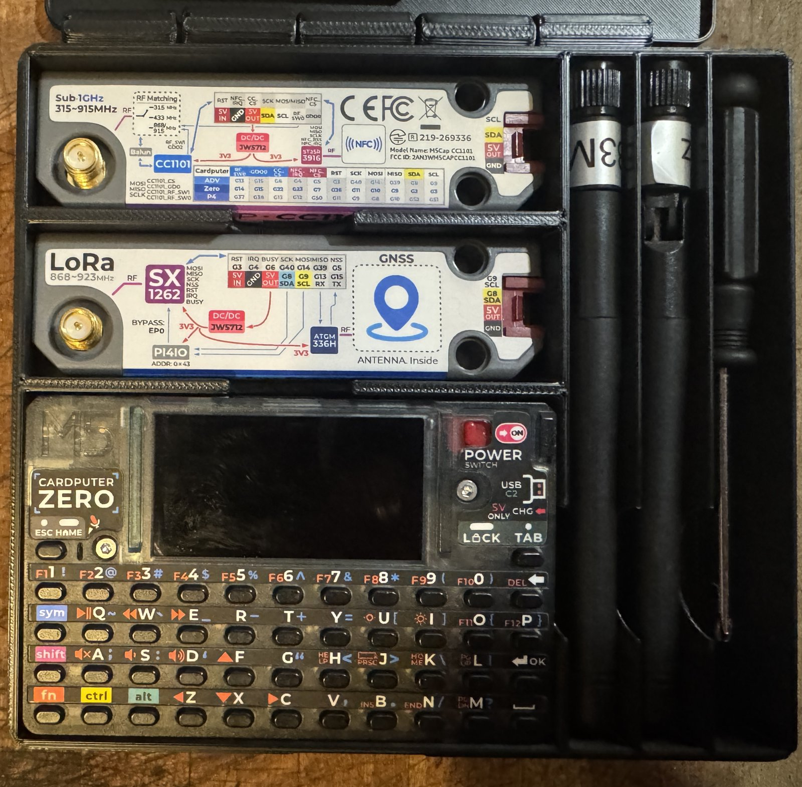
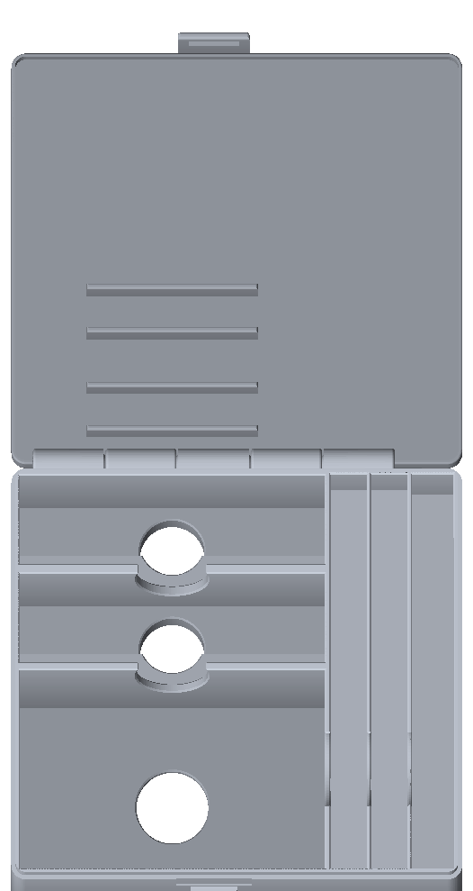

# M5Stack CardputerZero carry case

A flat, print-in-place carry case for an **M5Stack CardputerZero**, two **Caps** (CC1101 and
LoRa-1262, which are the same size), their two antennas and a small screwdriver. Modelled in Plasticity.

[Documentation and file map](docs/README.md) · [Project instructions](AGENTS.md) · [Session history](CHANGELOG.md)

## What it holds

| Pocket | Holds | Notes |
|---|---|---|
| Device | CardputerZero | Finger notch through the dividers to lift it out |
| Cap 1, Cap 2 | One Cap each | Shelf plus deeper clip slot so the cap sits flat and can't slide; ribs under the lid hold it down |
| Antenna 1, Antenna 2 | One antenna each | Channels along the side with a cross notch to pinch them out |
| Screwdriver | A small screwdriver | Slot to the right of the antennas, 11.6 mm wide, 109 mm long and 12.6 mm deep; the same cross notch reaches it |

**Push-out holes.** The device and both Caps fit snugly, so the floor has three round holes, one under
the device (20 mm) and one under each Cap (18 mm). Push up through the hole from underneath and the part
lifts out of its pocket. They sit in the middle of each pocket, clear of the Caps' clips.

The lid closes with a snap latch (a tab on the lid clicks over a ramped bump on the front wall).

## Printing

Print `exports/CardputerZero_Case.stl` (or open `exports/CardputerZero_Case.gcode.3mf` in Bambu Studio).
It prints **in one piece, opened flat, with the hinge already assembled**: no supports, no screws, no pins.

Tested on a Bambu Lab P1S:

- PETG, 0.4 mm nozzle, 0.20 mm layers
- 250 °C nozzle, 70 °C bed
- No supports
- About 2 h 55 min and 114 g
- Footprint 125.4 × 241.2 mm, so it needs a bed at least 245 mm long

After printing, open and close the lid a few times to free the hinge.

`exports/Hinge_Test.stl` is a 40 mm slice of the hinge. Print it first if you want to check your printer's
clearances before committing to the full case.

## Hinge design

- Three knuckles on the base and two on the lid, centered on the back edge, with the axis at mid-height so both halves lie flat when printed open.
- Knuckles turn on 45° cone pins with 0.4 mm clearance, and there's a 0.5 mm gap between knuckles.
- 45° gussets under the base knuckles mean nothing overhangs.
- The swing was collision-checked from 0° to 180°. The only contact is the latch snapping over its bump.

## Dimensions

Closed: 125.4 × 114 × 27.2 mm. Base walls 2.4 mm; lid 2 mm; all outer edges rounded.

## Files

| Path | What |
|---|---|
| `CardputerZeroCase.plasticity` | Source model (Plasticity). Note: the hinge in this file is still 6.4 mm left of center; the STL and 3MF have it centered |
| `exports/CardputerZero_Case.stl` | Print file: base and lid, in print position |
| `exports/CardputerZero_Case.gcode.3mf` | Sliced plate for a Bambu P1S, PETG |
| `exports/Hinge_Test.stl`, `.gcode.3mf` | Hinge test piece |
| `reference/` | M5Stack's official device and Cap models, used for fit (MIT, see `reference/official/NOTICE.md`) |

## Credits

- Device and Cap geometry: [M5Stack M5_Hardware](https://github.com/m5stack/M5_Hardware) (MIT).
- This case is a modification of Rockel83's *Cardputer Cap Locker* (Cap + antenna case) on MakerWorld.
  Its Cap pocket shape (shelf plus clip slot) is used here, set deeper in the base, with hold-down ribs added under the lid.
  All credit for that pocket design goes to Rockel83. Their original file is not included in this repository.
